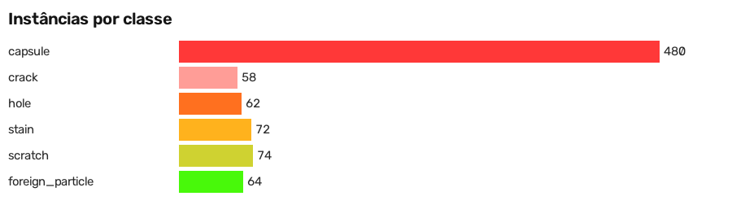
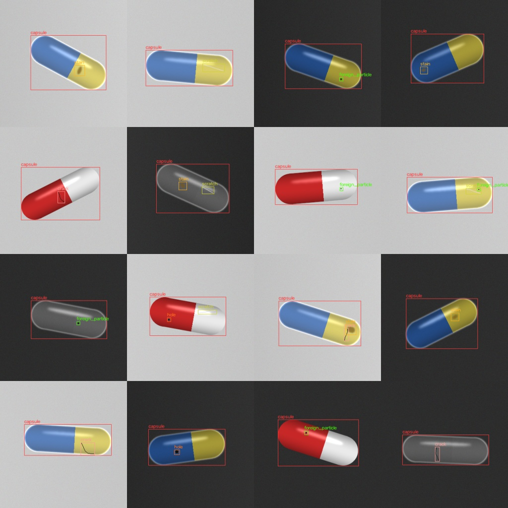

# Relatório de validação do dataset

- Raiz: `<projeto>/data/processed/synthetic`
- Tarefa: detect
- Imagens: 480 — objetos: 810
- Resultado: **OK** (0 erros, 0 avisos, 0 vazamentos)

## Distribuição por classe

| Classe | Instâncias | Imagens | Fração pequena (<32² px) |
|---|---:|---:|---:|
| capsule | 480 | 480 | 0.00 |
| crack | 58 | 58 | 0.86 |
| hole | 62 | 62 | 1.00 |
| stain | 72 | 72 | 1.00 |
| scratch | 74 | 74 | 0.78 |
| foreign_particle | 64 | 64 | 1.00 |

Razão de desequilíbrio (max/min, classes não vazias): 8.276

## Instâncias por split

| Split | capsule | crack | hole | stain | scratch | foreign_particle |
|---|---:|---:|---:|---:|---:|---:|
| test | 72 | 10 | 10 | 12 | 12 | 10 |
| train | 336 | 38 | 42 | 48 | 50 | 44 |
| val | 72 | 10 | 10 | 12 | 12 | 10 |

## Resolução

```
{
  "width": {
    "min": 320,
    "median": 320.0,
    "max": 320
  },
  "height": {
    "min": 320,
    "median": 320.0,
    "max": 320
  },
  "distinct": 1,
  "most_common": [
    [
      "320x320",
      480
    ]
  ]
}
```


## Divisão

```
{
  "n_images": 480,
  "n_groups": 240,
  "grouping_column": "unit_id",
  "split_images": {
    "train": 336,
    "val": 72,
    "test": 72
  },
  "split_groups": {
    "train": 168,
    "val": 36,
    "test": 36
  },
  "class_counts": {
    "train": {
      "capsule": 336,
      "crack": 38,
      "hole": 42,
      "stain": 48,
      "scratch": 50,
      "foreign_particle": 44
    },
    "val": {
      "capsule": 72,
      "crack": 10,
      "hole": 10,
      "stain": 12,
      "scratch": 12,
      "foreign_particle": 10
    },
    "test": {
      "capsule": 72,
      "crack": 10,
      "hole": 10,
      "stain": 12,
      "scratch": 12,
      "foreign_particle": 10
    }
  },
  "warnings": []
}
```




