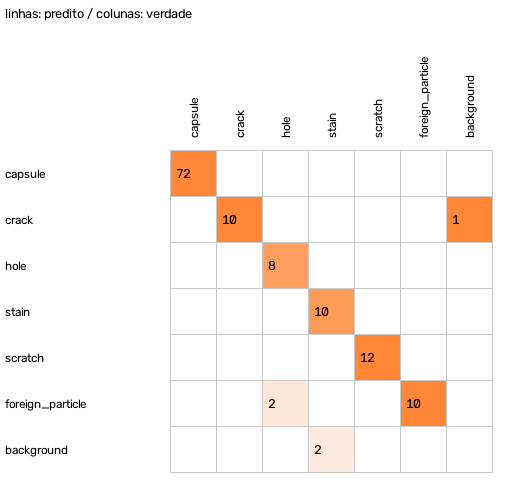
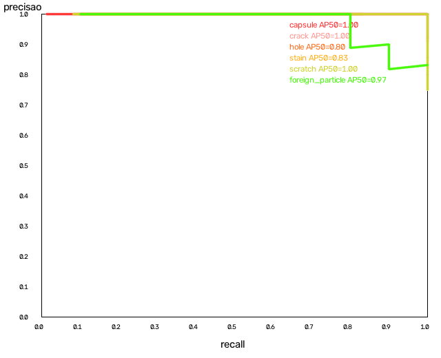
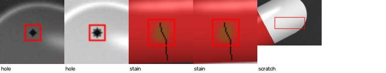
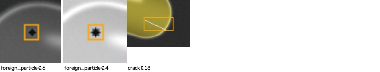

# Relatório de avaliação — split `test`

> **AVISO:** CONJUNTO SINTÉTICO: métricas sem valor de validação

- Modelo: `best_320_fp32.onnx` — backend `onnxruntime` — SHA-256 `344fb480e48b4aa2`
- Imagens: 72 — impressão digital do conjunto `6f66ebc2018b8117`
- mAP50 **0.935** · mAP50-95 **0.642**
- Defeitos (limiar de revisão): precisão 0.942 · recall 0.907 · F1 0.925 · taxa FN 0.093
- Decisão: escape (defeituosa aprovada) **0.023** · falsa rejeição 0.000 · revisão (defeituosas) 0.227 · revisão (boas) 0.000
- Decisão **com Modo C**: escape 0.023 · falsa rejeição 0.000 · revisão (defeituosas) 0.227 · revisão (boas) 0.000 — habilite o Modo C só se o ganho compensar
- Latência do modelo nesta máquina: p50 19.7 ms · p95 29.5 ms

## Por classe (ponto de operação = limiar de revisão)

| Classe | GT | AP50 | AP50-95 | Precisão | Recall | F1 | FN | FP | Recall pequenos (n) |
|---|---:|---:|---:|---:|---:|---:|---:|---:|---:|
| capsule | 72 | 1.000 | 0.945 | 1.000 | 1.000 | 1.000 | 0 | 0 | — (0) |
| crack | 10 | 1.000 | 0.691 | 0.909 | 1.000 | 0.952 | 0 | 1 | 1.000 (8) |
| hole | 10 | 0.802 | 0.554 | 1.000 | 0.800 | 0.889 | 2 | 0 | 0.800 (10) |
| stain | 12 | 0.832 | 0.499 | 1.000 | 0.833 | 0.909 | 2 | 0 | 0.833 (12) |
| scratch | 12 | 1.000 | 0.547 | 1.000 | 0.917 | 0.957 | 1 | 0 | 1.000 (8) |
| foreign_particle | 10 | 0.974 | 0.614 | 0.833 | 1.000 | 0.909 | 0 | 2 | 1.000 (10) |

## Por estrato de aquisição

### finish

| Valor | Imagens | Defeitos | Estado | Escape | Falsa rejeição |
|---|---:|---:|---|---:|---:|
| opaque | 28 | 26 | NOT_VALIDATED | 0.050 | 0.000 |
| translucent | 20 | 10 | NOT_VALIDATED | 0.000 | 0.000 |
| transparent | 24 | 18 | NOT_VALIDATED | 0.000 | 0.000 |

### color

| Valor | Imagens | Defeitos | Estado | Escape | Falsa rejeição |
|---|---:|---:|---|---:|---:|
| blue_yellow | 20 | 10 | NOT_VALIDATED | 0.000 | 0.000 |
| clear | 24 | 18 | NOT_VALIDATED | 0.000 | 0.000 |
| red_white | 28 | 26 | NOT_VALIDATED | 0.050 | 0.000 |

### lot

| Valor | Imagens | Defeitos | Estado | Escape | Falsa rejeição |
|---|---:|---:|---|---:|---:|
| L0 | 16 | 12 | NOT_VALIDATED | 0.000 | 0.000 |
| L1 | 20 | 20 | NOT_VALIDATED | 0.000 | 0.000 |
| L2 | 18 | 14 | NOT_VALIDATED | 0.000 | 0.000 |
| L3 | 18 | 8 | NOT_VALIDATED | 0.125 | 0.000 |

### lighting

| Valor | Imagens | Defeitos | Estado | Escape | Falsa rejeição |
|---|---:|---:|---|---:|---:|
| backlight | 36 | 27 | EVALUATED | 0.000 | 0.000 |
| diffuse | 36 | 27 | EVALUATED | 0.045 | 0.000 |

### profile

| Valor | Imagens | Defeitos | Estado | Escape | Falsa rejeição |
|---|---:|---:|---|---:|---:|
| synthetic | 72 | 54 | EVALUATED | 0.023 | 0.000 |

## Regressão contra referência: **APROVADA**

## Falsos negativos (amostra)

## Falsos positivos (amostra, maior confiança)

