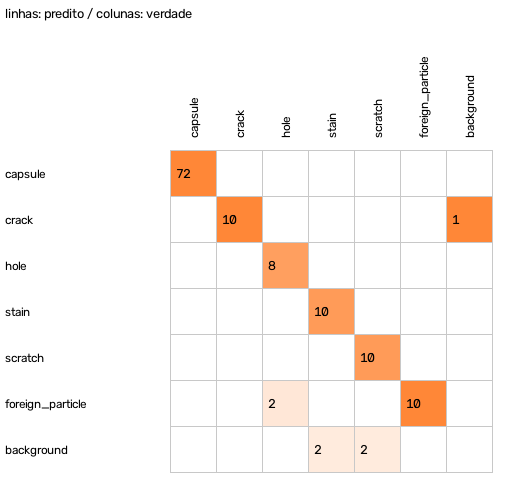
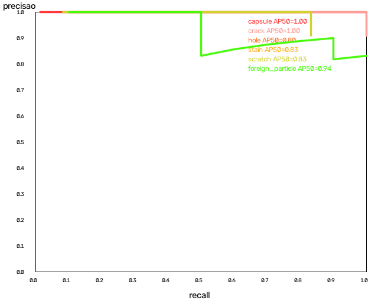
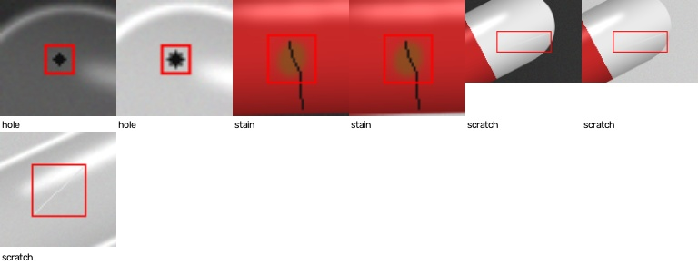
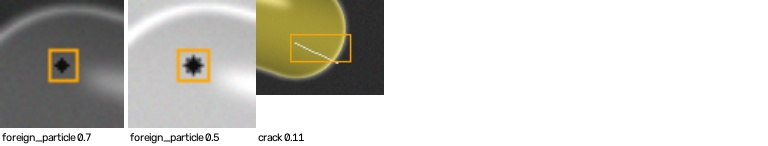

# Relatório de avaliação — split `test`

> **AVISO:** CONJUNTO SINTÉTICO: métricas sem valor de validação

- Modelo: `best_320_int8.onnx` — backend `onnxruntime` — SHA-256 `db2c3e5e5c83adc2`
- Imagens: 72 — impressão digital do conjunto `6f66ebc2018b8117`
- mAP50 **0.902** · mAP50-95 **0.620**
- Defeitos (limiar de revisão): precisão 0.940 · recall 0.870 · F1 0.904 · taxa FN 0.130
- Decisão: escape (defeituosa aprovada) **0.045** · falsa rejeição 0.000 · revisão (defeituosas) 0.182 · revisão (boas) 0.000
- Latência do modelo nesta máquina: p50 24.3 ms · p95 31.2 ms

## Por classe (ponto de operação = limiar de revisão)

| Classe | GT | AP50 | AP50-95 | Precisão | Recall | F1 | FN | FP | Recall pequenos (n) |
|---|---:|---:|---:|---:|---:|---:|---:|---:|---:|
| capsule | 72 | 1.000 | 0.931 | 1.000 | 1.000 | 1.000 | 0 | 0 | — (0) |
| crack | 10 | 1.000 | 0.622 | 0.909 | 1.000 | 0.952 | 0 | 1 | 1.000 (8) |
| hole | 10 | 0.802 | 0.537 | 1.000 | 0.800 | 0.889 | 2 | 0 | 0.800 (10) |
| stain | 12 | 0.832 | 0.532 | 1.000 | 0.833 | 0.909 | 2 | 0 | 0.833 (12) |
| scratch | 12 | 0.832 | 0.478 | 1.000 | 0.750 | 0.857 | 3 | 0 | 0.875 (8) |
| foreign_particle | 10 | 0.944 | 0.623 | 0.833 | 1.000 | 0.909 | 0 | 2 | 1.000 (10) |

## Por estrato de aquisição

### finish

| Valor | Imagens | Defeitos | Estado | Escape | Falsa rejeição |
|---|---:|---:|---|---:|---:|
| opaque | 28 | 26 | NOT_VALIDATED | 0.100 | 0.000 |
| translucent | 20 | 10 | NOT_VALIDATED | 0.000 | 0.000 |
| transparent | 24 | 18 | NOT_VALIDATED | 0.000 | 0.000 |

### color

| Valor | Imagens | Defeitos | Estado | Escape | Falsa rejeição |
|---|---:|---:|---|---:|---:|
| blue_yellow | 20 | 10 | NOT_VALIDATED | 0.000 | 0.000 |
| clear | 24 | 18 | NOT_VALIDATED | 0.000 | 0.000 |
| red_white | 28 | 26 | NOT_VALIDATED | 0.100 | 0.000 |

### lot

| Valor | Imagens | Defeitos | Estado | Escape | Falsa rejeição |
|---|---:|---:|---|---:|---:|
| L0 | 16 | 12 | NOT_VALIDATED | 0.000 | 0.000 |
| L1 | 20 | 20 | NOT_VALIDATED | 0.000 | 0.000 |
| L2 | 18 | 14 | NOT_VALIDATED | 0.000 | 0.000 |
| L3 | 18 | 8 | NOT_VALIDATED | 0.250 | 0.000 |

### lighting

| Valor | Imagens | Defeitos | Estado | Escape | Falsa rejeição |
|---|---:|---:|---|---:|---:|
| backlight | 36 | 27 | EVALUATED | 0.045 | 0.000 |
| diffuse | 36 | 27 | EVALUATED | 0.045 | 0.000 |

### profile

| Valor | Imagens | Defeitos | Estado | Escape | Falsa rejeição |
|---|---:|---:|---|---:|---:|
| synthetic | 72 | 54 | EVALUATED | 0.045 | 0.000 |

## Regressão contra referência: **REPROVADA**

- ✔ recall:capsule: novo 1.000 / ref 1.000
- ✔ recall:crack: novo 1.000 / ref 1.000
- ✔ recall_small:crack: novo 1.000 / ref 1.000
- ✔ recall:hole: novo 0.800 / ref 0.800
- ✔ recall_small:hole: novo 0.800 / ref 0.800
- ✔ recall:stain: novo 0.833 / ref 0.833
- ✔ recall_small:stain: novo 0.833 / ref 0.833
- ✘ recall:scratch: novo 0.750 / ref 0.917
- ✘ recall_small:scratch: novo 0.875 / ref 1.000
- ✔ recall:foreign_particle: novo 1.000 / ref 1.000
- ✔ recall_small:foreign_particle: novo 1.000 / ref 1.000
- ✘ map50: novo 0.902 / ref 0.935
- ✘ escape_rate: novo 0.045 / ref 0.023

## Falsos negativos (amostra)

## Falsos positivos (amostra, maior confiança)

