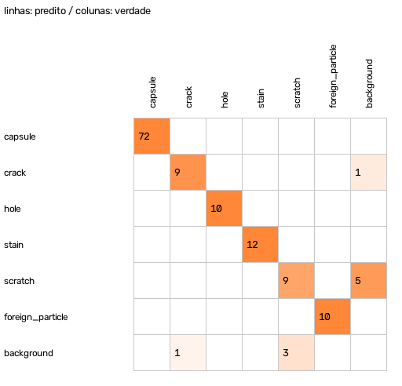
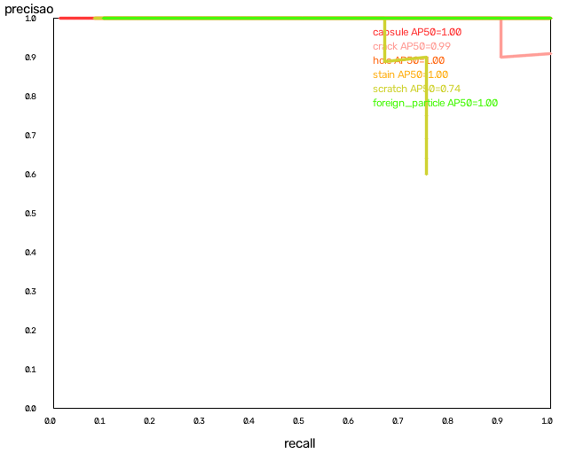

# Relatório de avaliação — split `val`

> **AVISO:** CONJUNTO SINTÉTICO: métricas sem valor de validação

- Modelo: `best.pt` — backend `ultralytics` — SHA-256 `f624be2b997ff024`
- Imagens: 72 — impressão digital do conjunto `5955662cf746f819`
- mAP50 **0.956** · mAP50-95 **0.694**
- Defeitos (limiar de revisão): precisão 0.893 · recall 0.926 · F1 0.909 · taxa FN 0.074
- Decisão: escape (defeituosa aprovada) **0.000** · falsa rejeição 0.000 · revisão (defeituosas) 0.250 · revisão (boas) 0.000
- Latência do modelo nesta máquina: p50 32.4 ms · p95 43.6 ms

## Por classe (ponto de operação = limiar de revisão)

| Classe | GT | AP50 | AP50-95 | Precisão | Recall | F1 | FN | FP | Recall pequenos (n) |
|---|---:|---:|---:|---:|---:|---:|---:|---:|---:|
| capsule | 72 | 1.000 | 0.921 | 1.000 | 1.000 | 1.000 | 0 | 0 | — (0) |
| crack | 10 | 0.991 | 0.562 | 0.900 | 0.900 | 0.900 | 1 | 1 | 0.875 (8) |
| hole | 10 | 1.000 | 0.776 | 1.000 | 1.000 | 1.000 | 0 | 0 | 1.000 (10) |
| stain | 12 | 1.000 | 0.802 | 1.000 | 1.000 | 1.000 | 0 | 0 | 1.000 (12) |
| scratch | 12 | 0.744 | 0.525 | 0.643 | 0.750 | 0.692 | 3 | 5 | 0.900 (10) |
| foreign_particle | 10 | 1.000 | 0.578 | 1.000 | 1.000 | 1.000 | 0 | 0 | 1.000 (10) |

## Por estrato de aquisição

### finish

| Valor | Imagens | Defeitos | Estado | Escape | Falsa rejeição |
|---|---:|---:|---|---:|---:|
| opaque | 22 | 12 | NOT_VALIDATED | 0.000 | 0.000 |
| translucent | 22 | 22 | NOT_VALIDATED | 0.000 | 0.000 |
| transparent | 28 | 20 | NOT_VALIDATED | 0.000 | 0.000 |

### color

| Valor | Imagens | Defeitos | Estado | Escape | Falsa rejeição |
|---|---:|---:|---|---:|---:|
| blue_yellow | 22 | 22 | NOT_VALIDATED | 0.000 | 0.000 |
| clear | 28 | 20 | NOT_VALIDATED | 0.000 | 0.000 |
| red_white | 22 | 12 | NOT_VALIDATED | 0.000 | 0.000 |

### lot

| Valor | Imagens | Defeitos | Estado | Escape | Falsa rejeição |
|---|---:|---:|---|---:|---:|
| L0 | 20 | 20 | NOT_VALIDATED | 0.000 | 0.000 |
| L1 | 10 | 6 | NOT_VALIDATED | 0.000 | 0.000 |
| L2 | 20 | 10 | NOT_VALIDATED | 0.000 | 0.000 |
| L3 | 22 | 18 | NOT_VALIDATED | 0.000 | 0.000 |

### lighting

| Valor | Imagens | Defeitos | Estado | Escape | Falsa rejeição |
|---|---:|---:|---|---:|---:|
| backlight | 36 | 27 | EVALUATED | 0.000 | 0.000 |
| diffuse | 36 | 27 | EVALUATED | 0.000 | 0.000 |

### profile

| Valor | Imagens | Defeitos | Estado | Escape | Falsa rejeição |
|---|---:|---:|---|---:|---:|
| synthetic | 72 | 54 | EVALUATED | 0.000 | 0.000 |

## Limiares sugeridos (calibrados na validação — revisar antes de aplicar)

| Classe | review | fail | recall máx | nota |
|---|---:|---:|---:|---|
| crack | 0.093 | 0.093 | 1.000 |  |
| hole | 0.750 | 0.750 | 1.000 |  |
| stain | 0.811 | 0.811 | 1.000 |  |
| scratch | — | 0.494 | 0.750 | recall alvo 0.95 inatingível (máx 0.750) |
| foreign_particle | 0.626 | 0.626 | 1.000 |  |

## Falsos negativos (amostra)

## Falsos positivos (amostra, maior confiança)

